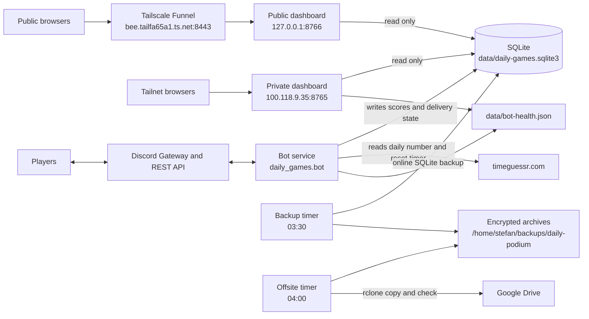
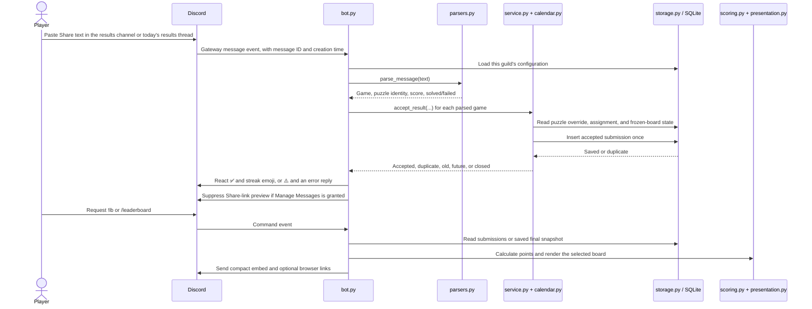

# Daily Podium: technical overview

This document describes the code and the deployment on **bee** as of 2026-11-15.
Daily Podium is one Discord bot serving multiple Discord servers (guilds). Each guild
has its own results channel, board channel, submission mode, timezone, cutoff, scoring setting, and
saved submissions. The private operations dashboard and public leaderboard are
separate web processes; neither receives Discord events or controls the bot.
Running processes load code at startup, so a code change takes effect after that
service is restarted.

## Processes and connections

| Process on bee | Systemd unit | Network role |
| --- | --- | --- |
| Discord bot | `daily-podium-bot.service` | Outbound Discord Gateway connection and Discord REST requests; no inbound web port |
| Private dashboard | `daily-podium-private-dashboard.service` | HTTP on Tailscale `100.118.9.35:8765`; `GET /` and `GET /api/data` |
| Public leaderboard | `daily-podium-public-dashboard.service` | HTTP on loopback `127.0.0.1:8766`; `GET /global`, `/s/<slug>`, and `/api/leaderboard` |
| Public HTTPS relay | Tailscale Funnel | Internet `https://bee.tailfa65a1.ts.net:8443/` to the public backend only |
| Backups | `daily-podium-backup.timer`, `daily-podium-offsite.timer` | Local encrypted archive, then encrypted copy to Google Drive |

The browser frontends are static files in `dashboard_static/`. Their JavaScript calls
their own Python process's JSON API about every 20 seconds. The private dashboard also
reads local health and backup markers; the public API returns an explicit allowlist of
scoreboard fields and omits Discord IDs, process status, and secrets. The public backend
uses short cache entries for repeated requests. Caddy does not route this app's public
dashboard; Tailscale Funnel forwards directly to its loopback backend.
`discord.py` uses the bot token from `.env` for an outbound Gateway session and REST
calls to register commands, read channel history, react, send embeds, and create threads.
Slash commands sync to `DEV_GUILD_ID` when set, or globally otherwise. Discord does not
call an HTTP endpoint on bee for interactions.

## From a pasted result to a leaderboard

`bot.py` listens to configured results channels and its saved daily results threads
for score ingestion. `parsers.py`
recognizes four Share formats. Scores are self-reported. For Wiki Game, the bot
checks the start and target against the official route for the competition date.
`calendar.py` maps numbered puzzles to competition dates and applies the guild's
cutoff. `service.py` checks the dated lineup, puzzle identity, and whether the
competition day is open. `storage.py` inserts valid results into SQLite. Accepted
single-game messages receive ✅ plus streak reactions; invalid input gets feedback.
For recognized Share messages, the bot also suppresses link previews when it has
Manage Messages in the results channel; it does not edit the player's text.

Each guild's standings are independent. `scoring.py` ranks TimeGuessr and Size It Up
by higher score, Metazooa by fewer guesses, and Wiki Game by fewer steps with time as
the tiebreaker. The guild's scoring rule turns those ranks into points.
`presentation.py` turns those results into a plain snapshot.
`discord_views.py` formats that snapshot as Discord embeds. `/myday`, weekly/monthly
boards, personal stats, and the dashboards reuse the same stored results or frozen
snapshots. The public **global** leaderboard is a derived view: it selects each user's
earliest accepted submission across guilds for each game in that date's global
lineup, then recalculates points for that shared field.

The bot keeps a parent-channel history cursor per guild and a separate cursor for
each daily results thread. After startup or a reconnect, it reads missed messages
in order and uses each message's original Discord creation time
when applying the cutoff. A per-guild asynchronous lock keeps recovery, live ingestion,
and finalization from racing. A file lock prevents two bot processes from writing the
same database. Edited messages that were never recorded are skipped during recovery
because Discord history no longer contains their original content.

## Daily posting

The bot's `daily_tick` runs every 30 seconds. For a midnight cutoff in
`Europe/Berlin`, the sequence is:

1. In thread mode, at the **00:00** cutoff, create today's parent prompt and its
   public results thread. Pin the prompt in the parent channel and one guide
   with links and submission instructions in the thread. Remove the previous
   bot-owned parent pin. Early
   parent-channel messages posted while the bot was offline are still recovered.
2. At or after **00:05**, recover missed results and freeze yesterday's board. Standard
   style posts the compact final embed in the configured board channel. Compact thread
   style posts it in yesterday's results thread and includes the highlights, full
   results, and weekly summary in the same message when they fit. Otherwise,
   details follow in the thread. Failures retry without changing the frozen board.
3. At or after **08:05**, compact thread style edits today's pinned parent with the
   current month's finalized top three, yesterday's winner, and a thread invitation.
   This happens even if TimeGuessr has not reset. Both thread styles update the
   pinned guide in place once the puzzle is ready, or by noon with a warning.
   Channel mode posts a links/status embed. Other games can be submitted before
   this update.
4. `/status` reads TimeGuessr's live next-reset timer for its response. The timer and
   current puzzle number come from TimeGuessr over HTTPS. If its page cannot be read,
   the bot uses a general reset warning and still sends the links post.

For other guild cutoffs, the final board is due five minutes after their configured
cutoff. Channel-mode links post no earlier than 08:05 in that guild's timezone and
no earlier than its previous final board. Thread-mode prompts open at cutoff and
receive the morning update at or after 08:05. Each guild stores `language` (`en` or
`de`) and `announcement_style` (`standard` or `compact`) in `servers`; `!language`
and `!announcement_style` change only that guild. `result_modes`, `boards`, `board_details`,
and `daily_prompts` store mode history, delivery state, cursors, attempted times,
pins, and Discord message IDs. If a send times out after
Discord accepted it, the bot searches channel or thread history for its unique embed
footer before retrying. Discord and SQLite cannot make one atomic transaction, so
this reduces duplicate posts but cannot guarantee strict exactly-once delivery under
every network failure. Old days do not receive backfilled game-links posts.

## Where the code lives

The supported game catalog is separate from the active lineup. `rotation.py`
reads dated global and server changes from SQLite. Live and recovered results
resolve the lineup using the submission's competition date. Server snapshots
record the lineup for their date, and cross-server standings use the global
lineup for each date. A snapshot created before rotations uses the original trio.

`wiki_daily.py` reads the dated route data from the public script linked by the
official game page. It caches individual routes in SQLite. Share text supplies
steps and time, while the cached route establishes puzzle identity. Wiki Game
submissions and snapshots store elapsed seconds separately from steps.

| File or group | Responsibility and output |
| --- | --- |
| `__main__.py` | Loads `.env`, opens SQLite, holds the single-writer file lock, starts the Discord bot |
| `bot.py` | Gateway events, prefix/slash commands, result reactions, scheduled board/thread/links posts, Discord API calls |
| `i18n.py` | English/German Discord text helpers and parser-feedback translations |
| `parsers.py`, `models.py` | Share-text parsing and typed game, submission, and guild settings data |
| `calendar.py`, `service.py` | Puzzle-date mapping, cutoffs, acceptance rules, and result rejection messages |
| `storage.py` | SQLite schema and writes for settings, submissions, frozen boards, delivery state, overrides, and audit entries |
| `scoring.py`, `presentation.py`, `periods.py`, `streaks.py` | Points, ranks, snapshots, weekly/monthly aggregation, and streak calculations |
| `discord_views.py` | Embed text for compact boards, details, period boards, and player stats |
| `timeguessr.py` | Reads TimeGuessr's live daily number and next-reset timer; does not fetch player scores |
| `dashboard.py`, `dashboard_static/index.html`, `dashboard_static/dashboard.js` | Private read-only JSON API and operations UI |
| `public_dashboard.py`, `dashboard_static/public.html`, `dashboard_static/public.js` | Public allowlisted leaderboard API and browser UI |
| `public_links.py` | Opaque per-guild URL slugs and local public-link metadata; bot adds links to Discord boards |
| `health.py`, `backup.py`, `scripts/sync-backups-to-gdrive.sh` | Local health record, verified encrypted backup, and offsite copy/check |
| `deploy/systemd/user/` | Service definitions and timers used on bee |

## Data and trust boundaries

- **SQLite** defaults to `data/daily-games.sqlite3` with WAL enabled. `servers`
  contains guild settings and the history cursor; `submissions` contains accepted
  scores; `boards` contains frozen snapshots; `board_details` and `daily_prompts`
  track Discord delivery; `puzzle_dates` holds admin corrections; `audit` records
  administrative changes. Only the bot opens it for application writes. Both web
  processes use read-only SQLite connections.
- **Local secrets and state:** `.env` contains the Discord token;
  `data/public-links.key` derives stable public guild slugs;
  `data/public-dashboard.json` holds the public origin and display names;
  `data/.backup-password` holds the archive password; `data/bot-health.json` and
  `data/offsite-last-success.txt` are local status files.
  These files and the SQLite database are outside Git. The dashboard has no bot
  command or process-control endpoint.
- **Backups:** `backup.py` uses SQLite's online backup API, encrypts and verifies an
  archive containing the database and available configuration files, then the
  offsite script uses `rclone` to copy/check encrypted archives in
  `gdrive:daily-podium-backups`. The separate backup password is never included in
  those archives.
- **External services:** Discord carries commands, result messages, reactions,
  embeds, and threads. The bot reads TimeGuessr's daily number and reset timer
  when TimeGuessr is active. The Wiki Game Daily supplies dated routes for
  validation. Magnitudle and Metazooa appear as play links. Tailscale carries
  private dashboard access and the public Funnel relay.

For setup and permissions see [README.md](README.md). For the current service commands
and backup procedure see [SYSTEMD.md](SYSTEMD.md). For web routes and public-data rules
see [DASHBOARD.md](DASHBOARD.md) and [PUBLIC_DASHBOARD.md](PUBLIC_DASHBOARD.md).
